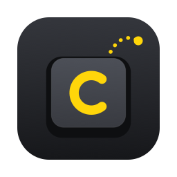
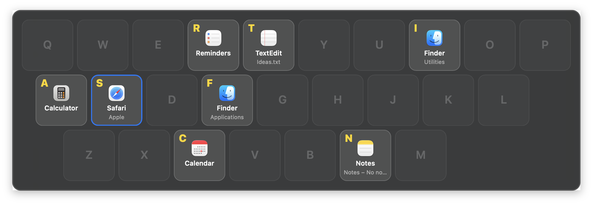
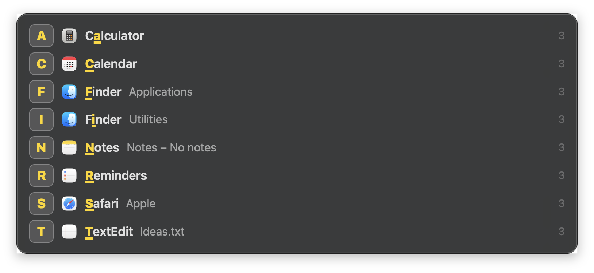

<p align="center"></p>

<h1 align="center">Capjump</h1>

<p align="center"><strong>Jump to any window on macOS by pressing one letter.</strong></p>

Press the hotkey and every open window, on every Space, appears with a
letter. Press the letter and you're there. You don't cycle through windows
or search for them, and the same window keeps the same letter, so after a day
you don't even need to look.



- **One keystroke per switch.** Opening the panel and switching takes two keys.
  There's no Tab-Tab-Tab and no typing a search.
- **Stable letters.** Pin apps to keys (`S` → Safari, `T` → Terminal). Every
  other window keeps the letter it got, which is the first free letter of its
  app name when possible.
- **All Spaces, all displays.** Focusing a window on another Space takes you
  there.
- **Works on its own.** It has a built-in global hotkey and doesn't need a
  window manager. If you already run [yabai](https://github.com/koekeishiya/yabai)
  or [skhd](https://github.com/koekeishiya/skhd), it works with them too.
- **Can replace Cmd+Tab** if you want it to.
- **Fast.** It runs in the background and the panel opens in about 50ms.
- **Browser profiles.** Chrome, Edge, Brave and other Chromium windows show
  which profile they belong to, and you can pin by profile.

There's also a compact list layout, where the letter is highlighted in the
app name when it appears there:



## Install

You need macOS 13 or later and the Xcode Command Line Tools
(`xcode-select --install`).

```sh
git clone https://github.com/samvel1024/capjump.git
cd capjump
make install
```

This builds `Capjump.app` into `~/Applications`, links the `capjump` CLI into
`~/.local/bin`, writes a starter config to `~/.config/capjump/config.json`
(without overwriting an existing one) and starts Capjump at login through a
launchd agent.

Press **Option+Tab**.

### Permissions

Capjump needs **Accessibility** for the native backend (reading window titles
and types, raising windows) and for overriding Cmd+Tab. macOS asks for it the
first time Capjump starts. Turn it on in **System Settings → Privacy &
Security → Accessibility**; it takes effect without a restart.

With yabai as the backend and a hotkey other than Cmd+Tab, Capjump needs no
permissions at all. It never needs Screen Recording.

> The build is ad-hoc signed, with its code requirement pinned to the bundle
> id, so the permission keeps working after you rebuild. If macOS keeps asking
> although Capjump is switched on (for example, after upgrading from an older
> build), run `tccutil reset Accessibility io.github.samvel1024.capjump` and
> grant it again.

## Usage

| Key | Action |
|---|---|
| hotkey | show / hide the panel |
| letter | focus that window |
| Esc, or click elsewhere | close |

```text
capjump                run the switcher (launchd does this at login)
capjump toggle         show/hide the panel of the running instance
capjump reload         re-read the hotkey after editing the config
capjump list           print windows and their letters
  --config <path>     use a different config file
```

## Configuration

`~/.config/capjump/config.json` is re-read every time the panel opens, so
changes to rules, layout and scale take effect immediately. After changing
`hotkey`, run `capjump reload`.

```json
{
  "hotkey": "alt+tab",
  "layout": "keyboard",
  "backend": "auto",
  "scale": 1.2,
  "rules": [
    { "key": "s", "app": "^Safari$" },
    { "key": "t", "app": "^(Terminal|iTerm2|WezTerm|Ghostty)$" },
    { "key": "c", "app": "^Google Chrome$", "title": " - Personal$" },
    { "key": "w", "app": "^Google Chrome$", "title": " - Work$" }
  ],
  "ignore": [
    { "app": "^System Settings$" }
  ]
}
```

| Key | Default | |
|---|---|---|
| `hotkey` | `"alt+tab"` | Modifiers `cmd`, `alt`/`opt`, `ctrl`, `shift`, joined with `+` to a key: a letter, digit, `tab`, `space`, `return`, `` ` ``, `f1`–`f20`, or a raw key code such as `0x5A`. `"cmd+tab"` replaces the system switcher. `"none"` disables the built-in hotkey; use this if you trigger Capjump from another tool. |
| `layout` | `"keyboard"` | `"keyboard"` shows windows on a QWERTY map. `"list"` shows one row per window. |
| `backend` | `"auto"` | `"auto"` uses yabai when it's running and the native backend otherwise. You can also force `"yabai"` or `"native"`. |
| `scale` | `1.2` | Size of the panel. |
| `rules` | `[]` | Pins `key` to the first window matching `app` and/or `title`. Patterns are case-insensitive regular expressions. A pinned key is reserved even when its app isn't running. |
| `ignore` | `[]` | Hides windows matching `app` and/or `title`. |

**How letters are picked:** pinned keys are assigned first. Every other window
keeps the letter it had the last time the panel opened. A new window gets the
first free letter of its app name, otherwise the next free key, home row
first.

**Chrome profiles:** Chromium browsers end window titles with
` - Google Chrome - <Profile>` once you have more than one profile. Capjump
shows the profile separately, and rules can match it with a `title` pattern
such as `" - Work$"`.

## Using it with skhd, yabai or Karabiner

Set `"hotkey": "none"` and toggle Capjump from whatever already manages your
keyboard. Sending the signal directly is the fastest way:

```sh
# skhd
alt - space : pkill -USR1 -x capjump
```

`capjump toggle` does the same thing in a more readable way.

When yabai is running, Capjump takes its window list from yabai, so it lists
exactly the windows yabai manages, and focusing goes through yabai.

## How it works

- **Window list:** comes from `yabai -m query --windows`. Without yabai, it
  comes from `CGWindowListCopyWindowInfo`, plus SkyLight's per-window Space
  lookup, which drops minimized windows and offscreen buffers. Each window is
  then matched to its Accessibility element, which provides the full title
  and the window type, and filters out helper surfaces. Accessibility hides
  windows on other Spaces, so for those Capjump addresses the app's elements
  directly by forging their remote tokens (the technique AltTab uses). The
  result is cached per window, and Capjump refreshes it in the background so
  opening the panel stays instant.
- **Focusing:** the native backend does what yabai does without its scripting
  addition: `_SLPSSetFrontProcessWithOptions` (which also switches Spaces), a
  synthetic make-key event, then an Accessibility raise. No SIP changes are
  needed. Private symbols are looked up at runtime, so a future macOS that
  removes one degrades instead of crashing.
- **Hotkey:** regular combos are Carbon `RegisterEventHotKey` hotkeys, which
  need no permissions. Cmd+Tab and Cmd+\` belong to the system, so for those
  Capjump installs a session event tap that consumes the keystroke before the
  Dock sees it.
- **Panel:** a non-activating `NSPanel`. It takes keyboard focus without
  activating Capjump, so pressing Esc leaves you exactly where you were.

## Uninstall

```sh
make uninstall          # leaves ~/.config/capjump in place
```

## License

MIT
